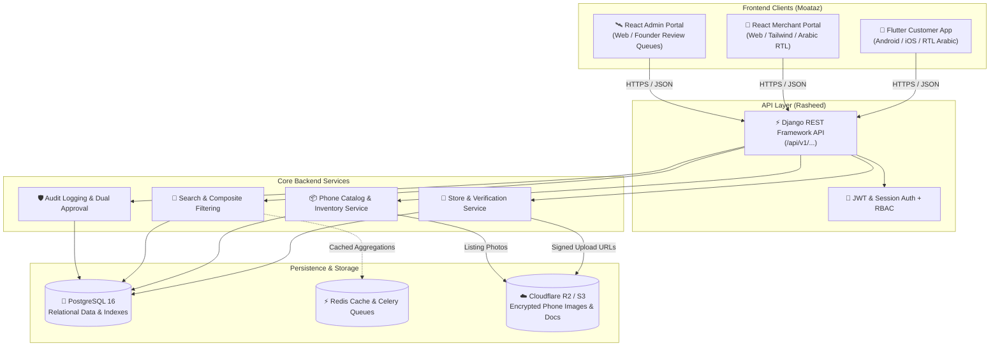
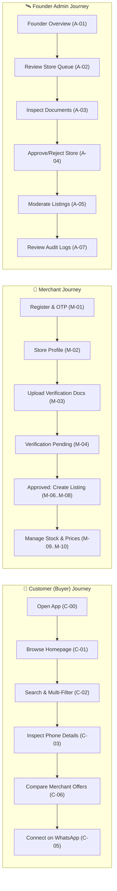
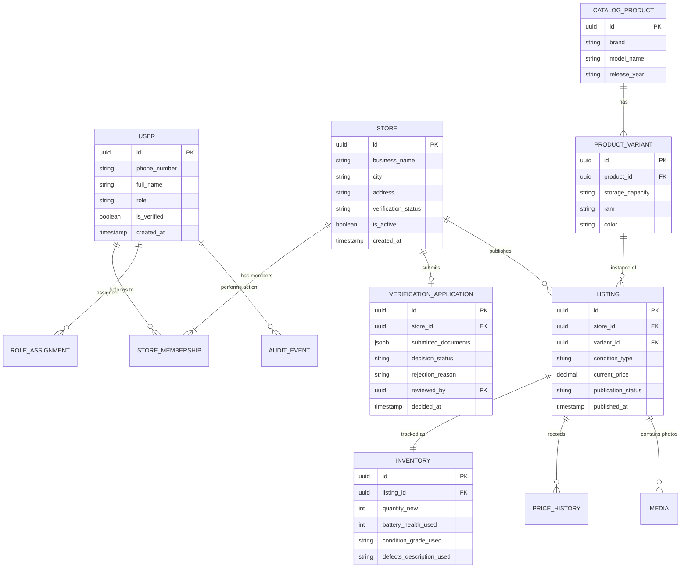
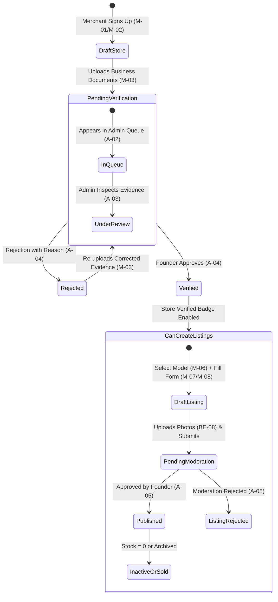

# 📱 Souq Phone: Master Step-by-Step Delivery Plan

> **Interactive Delivery Blueprint & Release Execution Guide**  
> **Source Blueprint:** [Live Blueprint Board](https://preview-chat-d59fa41d-a7de-46a1-b545-0898397f953f.space-z.ai/)  
> **Repository:** `MobaileyProject/sudan-phones`  
> **Owners:** 
> - 🛠️ **Backend (`[BE]`):** Rasheed ([@marco47t](https://github.com/marco47t) / Slack `U0CHXBNE6F4`) — Django REST Framework, PostgreSQL 16, Cloudflare R2, Celery/Redis
> - 🎨 **Frontend (`[FE]`):** Moataz ([@MoatazAbdElmutaal](https://github.com/MoatazAbdElmutaal)) — Flutter Customer Mobile App (iOS/Android) & React Merchant/Admin Web Portal
> - 🤝 **Joint (`[JOINT]`):** Both Founders — Scope, Contracts, Acceptance Gates, and Go/No-Go Release Decisions

---

## 🎯 How to Use This Plan Step-by-Step

This plan is organized into **8 strict linear steps**. You execute them sequentially:
1. **Focus on ONE step at a time** (e.g., **Step 1**).
2. Within that step, Rasheed works on `[BE]` tasks while Moataz works on `[FE]` tasks against agreed API contracts.
3. Every task has a clickable checkbox `[ ]`. Tick off each task as its PR is reviewed and merged.
4. When all tasks in the step are complete, execute the **Joint Acceptance Checkpoint (`INT-XX`)**.
5. Once `INT-XX` passes, tick the **Step Release Gate (`GATE-XX`)** to officially complete the step and unlock the next step!

```
[ Step 1: Planning & Scope ] ──────► GATE-01 Passed ──────┐
                                                          │
┌─────────────────────────────────────────────────────────┘
▼
[ Step 2: Foundation & Shells ] ──► GATE-02 Passed ──────┐
                                                          │
┌─────────────────────────────────────────────────────────┘
▼
[ Step 3: Identity & Verification ] ► GATE-03 Passed ────┐
                                                          │
┌─────────────────────────────────────────────────────────┘
▼
[ Step 4: Catalog & Listings ] ──► GATE-04 Passed ───────┐
                                                          │
┌─────────────────────────────────────────────────────────┘
▼
[ Step 5: Customer Discovery ] ──► GATE-05 Passed ───────┐
                                                          │
┌─────────────────────────────────────────────────────────┘
▼
[ Step 6: Merchant & Admin Ops ] ─► GATE-06 Passed ──────┐
                                                          │
┌─────────────────────────────────────────────────────────┘
▼
[ Step 7: Testing & Hardening ] ──► GATE-07 Passed ──────┐
                                                          │
┌─────────────────────────────────────────────────────────┘
▼
[ Step 8: Pilot Launch ] ────────► GATE-08: LIVE IN PRODUCTION! 🚀
```

---

## 📋 Quick Navigation & Slack Lists Hub

All 136 items are mirrored in your Slack Workspace (**Elrasheed Workplace** `T0CJRU4RSUQ`):
- 🗺️ **[Slack Delivery Roadmap](https://elrasheedworkplace.slack.com/lists/T0CJRU4RSUQ/F0CHUDFCXKP)** (`F0CHUDFCXKP`): 8 Phase Gates (`GATE-01`..`08`) and 14 Milestones (`MILE-01`..`14`).
- 📋 **[Slack Implementation Backlog](https://elrasheedworkplace.slack.com/lists/T0CJRU4RSUQ/F0CHWFG1BD4)** (`F0CHWFG1BD4`): 54 Implementation tasks (`SCOPE-01`, `BE-01`..`12`, `FE-00`, `C-00`..`C-10`, `M-01`..`M-13`, `A-01`..`A-09`, `INT-01`..`08`).
- 🔌 **[Slack API Contracts](https://elrasheedworkplace.slack.com/lists/T0CJRU4RSUQ/F0CHJB5C939)** (`F0CHJB5C939`): 60 Proposed API operations (`API-001`..`API-060`).

---

## 📐 Architecture & System Flow Diagrams

### Diagram 1: High-Level System Architecture & Component Split



---

### Diagram 2: End-to-End User Journeys (Buyer, Merchant, Founder Admin)



---

### Diagram 3: Relational Data Architecture (Entity Relationship Diagram)



---

### Diagram 4: Merchant Verification & Listing Moderation Lifecycle



---

## 🚀 The 8 Sequential Delivery Steps

---

### 🧭 Step 1 (Phase 1): Scope, Business Invariants & Architecture Sign-Off

> **Goal:** Settle all MVP product decisions, business rules, screen inventories, and technology invariants before writing code.  
> **Roadmap Reference:** `GATE-01` (`Rec0CHJB6225D`) | `MILE-01` (`Rec0CJU3XJACQ`)  
> **Joint Checkpoint:** `INT-01` (`Rec0CJ1L4Q8EM`)  
> **Dependencies:** None — Starting Point

#### Step 1 Work Checklist:
- [ ] `[JOINT]` **SCOPE-01 — Resolve Core Business Invariants & Decisions** (Slack: `Rec0CHT7ACRJ9`)
  - Confirm single currency: **Sudanese Pound (SDG)** across all pricing and offers.
  - Settle pilot launch region: **Port Sudan / Khartoum / Omdurman**.
  - Agree on inventory distinction:
    - **New phones:** Tracked by stock quantity (`quantity >= 1`), warranty terms, and sealed box flag.
    - **Used phones:** Tracked as distinct individual units with battery health %, physical condition grade, and explicit defects notes.
  - Settle Customer Account scope: Public guest browsing and search requires **no login**; account creation is optional.
  - Settle Home Promotions: Core homepage works without paid advertisements; ad campaigns deferred post-MVP.
- [ ] `[BE]` **Rasheed: Business Rules & Verification Policy Spec**
  - Document required merchant verification evidence (National ID, Commercial Register / Store signboard photo).
  - Draft state machine for store statuses: `draft` ➔ `pending_verification` ➔ `verified` / `rejected` / `suspended`.
- [ ] `[FE]` **Moataz: Screen Inventory & Journey Mapping Sign-Off**
  - Validate customer journey (C-00..C-10), merchant portal (M-01..M-13), founder admin (A-01..A-09).
  - Confirm bilingual Arabic RTL first, English secondary.

> #### 🏁 Step 1 Exit Gate Criteria (`GATE-01` / `INT-01`):
> - [ ] Both founders sign off on `SCOPE-01`.
> - [ ] Screen IDs (33 screens) locked and mapped.
> - [ ] Invariants for New vs Used inventory committed.
> - [ ] **Action:** Check off `INT-01` in Slack Backlog and `GATE-01` in Slack Roadmap to unlock Step 2!

---

### 🧱 Step 2 (Phase 2): Infrastructure & Dual Client Shells Foundation

> **Goal:** Initialize backend API server, PostgreSQL database, mobile Flutter shell, React merchant/admin shells, design system, and CI pipelines.  
> **Roadmap Reference:** `GATE-02` (`Rec0CHZGTHJBU`) | `MILE-02` (`Rec0CHTFK1LMR`), `MILE-03` (`Rec0CHZGVE4D8`), `MILE-04` (`Rec0CHTFL1V19`)  
> **Joint Checkpoint:** `INT-02` (`Rec0CJ1L4EWGZ`)  
> **Prerequisites:** Step 1 (`GATE-01`) completed.

#### Step 2 Work Checklist:
- [ ] `[BE]` **BE-01: Django 5 + DRF Project Baseline & CI** (Slack: `Rec0CHJBWSUKZ`)
  - Initialize clean Django REST Framework project structure.
  - Configure PostgreSQL 16 database connection and initial migration baseline.
  - Set up Cloudflare R2 / S3 storage credentials & bucket connection.
  - Configure GitHub Actions CI for linting, secret scanning, and automated tests.
- [ ] `[BE]` **BE-02: Configuration, Localization & Shared API Conventions** (Slack: `Rec0CHZGWCSW1`)
  - Implement shared JSON error envelope `{"error": {"code": "...", "message": "...", "details": [...]}}`.
  - Implement **API-019**: `GET /api/v1/config` (App version, supported cities, currency settings).
  - Implement **API-021**: `GET /api/v1/i18n/bundle` (Arabic & English localization strings).
- [ ] `[FE]` **FE-00: Dual Client Foundation & Design System** (Slack: `Rec0CHJBZ8K28`)
  - Scaffold Flutter mobile customer app with Riverpod/Bloc and RTL support.
  - Scaffold React web portal with Vite, Tailwind CSS, and RTL layout engine.
  - Set up shared color tokens, typography, and bilingual localization dictionaries.
- [ ] `[FE]` **C-00: Application Entry & Splash** (Slack: `Rec0CJU47CBA9` | Screens: `C-00` | APIs: `API-019`, `API-021`)
  - Splash screen, network connectivity check, and remote config bootstrap.
- [ ] `[FE]` **C-09: Loading, Empty & Offline UI States** (Slack: `Rec0CHZGQ2M9U` | Screens: `C-09`)
  - Reusable components for skeleton loaders, empty search states, offline warnings, and error retry buttons.

> #### 🏁 Step 2 Exit Gate Criteria (`GATE-02` / `INT-02`):
> - [ ] Backend CI passes with baseline migrations and health check.
> - [ ] Flutter customer app boots and renders `C-00` on Android/iOS.
> - [ ] React portal boots and renders responsive navigation shell.
> - [ ] Real `GET /api/v1/config` and `GET /api/v1/i18n/bundle` return 200 OK to both clients.
> - [ ] **Action:** Check off `INT-02` in Slack Backlog and `GATE-02` in Slack Roadmap to unlock Step 3!

---

### 🔐 Step 3 (Phase 3): Identity, Store Onboarding & Founder Verification

> **Goal:** Build authentication, merchant registration, store profiles, verification document uploads, and founder review queues.  
> **Roadmap Reference:** `GATE-03` (`Rec0CHXP9N1GE`) | `MILE-05` (`Rec0CHZGW3TPU`), `MILE-06` (`Rec0CHZGW4W3C`)  
> **Joint Checkpoint:** `INT-03` (`Rec0CHZHV8N58`)  
> **Prerequisites:** Step 2 (`GATE-02`) completed.

> [!IMPORTANT]
> **Sequencing Rule:** Admin verification screens (`A-02`, `A-03`, `A-04`) are built in this step alongside merchant registration (`M-01`..`M-04`). This ensures the end-to-end verification lifecycle can be executed and tested immediately.

#### Step 3 Work Checklist:
- [ ] `[BE]` **BE-03: Identity, Sessions & Scoped Authorization** (Slack: `Rec0CHUDY6NEX`)
  - Implement JWT/session auth with role-based permissions (`buyer`, `merchant`, `admin`).
  - Implement **API-049**: `POST /api/v1/auth/register` (Customer registration).
  - Implement **API-047**: `POST /api/v1/auth/login` (Authentication endpoint).
  - Implement **API-048**: `POST /api/v1/auth/recover` (Password recovery / OTP).
  - Implement **API-002**: `DELETE /api/v1/auth/session` (Logout / revoke token).
  - Implement **API-051**: `POST /api/v1/merchant/auth/register` (Merchant account creation).
  - Implement **API-052**: `POST /api/v1/merchant/auth/verify` (Phone verification OTP).
- [ ] `[BE]` **BE-04: Store Profile, Membership & Settings** (Slack: `Rec0CHUDY20F4`)
  - Implement store models, ownership records, and membership roles.
  - Implement **API-030**: `GET /api/v1/stores/me` (Fetch current merchant store profile).
  - Implement **API-060**: `PUT /api/v1/stores/me/profile` (Update business info & location).
  - Implement **API-055**: `POST /api/v1/stores/me/staff` (Add staff member).
  - Implement **API-004**: `DELETE /api/v1/stores/me/staff/{id}` (Remove staff member).
  - Implement **API-059**: `PUT /api/v1/stores/me` (Update store general settings).
- [ ] `[BE]` **BE-05: Verification Evidence Submission & Founder Review** (Slack: `Rec0CHZGSE1J7`)
  - Verification document ingestion, audit trail, and founder decision state transitions.
  - Implement **API-056**: `POST /api/v1/stores/me/verification/documents` (Upload verification docs).
  - Implement **API-057**: `POST /api/v1/stores/me/verification/submit` (Submit application).
  - Implement **API-035**: `GET /api/v1/stores/me/verification` (Check verification status).
  - Implement **API-011**: `GET /api/v1/admin/verifications` (Founder pending queue).
  - Implement **API-012**: `GET /api/v1/admin/verifications/{id}` (Review specific store evidence).
  - Implement **API-013**: `GET /api/v1/admin/verifications/{id}/documents` (Private document stream).
  - Implement **API-046**: `POST /api/v1/admin/verifications/{id}/decision` (Approve / Reject decision).
- [ ] `[FE]` **C-07: Customer Account & Auth** (Slack: `Rec0CHUDZZ5EU` | Screens: `C-07`)
  - Customer login, sign-up, password reset, and profile management in Flutter app.
- [ ] `[FE]` **M-01: Merchant Registration** (Slack: `Rec0CHTGCK66G` | Screens: `M-01`)
  - Merchant signup, phone number input, and OTP verification screen in React portal.
- [ ] `[FE]` **M-02: Business Information** (Slack: `Rec0CJU4U4SGB` | Screens: `M-02`)
  - Store name, city, market address, and contact details form.
- [ ] `[FE]` **M-03: Business Verification Document Upload** (Slack: `Rec0CHJC5HJ8P` | Screens: `M-03`)
  - Drag-and-drop document upload (National ID / Commercial Register) with upload progress.
- [ ] `[FE]` **M-04: Verification Status Tracker** (Slack: `Rec0CJU4UNYKS` | Screens: `M-04`)
  - Status banner (`Under Review`, `Approved`, `Rejected` with reason and re-submit button).
- [ ] `[FE]` **A-02: Founder Store Verification Queue** (Slack: `Rec0CJU4VMADN` | Screens: `A-02`)
  - Table of pending store applications with submission timestamps and status filters.
- [ ] `[FE]` **A-03: Review Store Evidence** (Slack: `Rec0CHJC6BYTZ` | Screens: `A-03`)
  - Modal/page to inspect uploaded ID documents, store info, and applicant details.
- [ ] `[FE]` **A-04: Verification Decision Action** (Slack: `Rec0CJ3EHGRB6` | Screens: `A-04`)
  - Actions: Approve store (activates verified badge) or Reject store (requires mandatory reason).

> #### 🏁 Step 3 Exit Gate Criteria (`GATE-03` / `INT-03`):
> - [ ] A new merchant can sign up, fill business info, and submit ID documents.
> - [ ] Founder can log into Admin, view the submission, and approve the store.
> - [ ] Audit trail records the decision with timestamp and admin actor ID.
> - [ ] Unverified store attempting to publish a listing receives a strict 403 Forbidden.
> - [ ] **Action:** Check off `INT-03` in Slack Backlog and `GATE-03` in Slack Roadmap to unlock Step 4!

---

### 📦 Step 4 (Phase 4): Catalog, Listings, Stock & Media Ingestion

> **Goal:** Build the phone catalog taxonomy, new/used listing models, stock management, price history, Cloudflare R2 media uploads, and listing moderation.  
> **Roadmap Reference:** `GATE-04` (`Rec0CHUDPL2BF`) | `MILE-07` (`Rec0CHXPC7CMC`)  
> **Joint Checkpoint:** `INT-04` (`Rec0CHJC7NSJK`)  
> **Prerequisites:** Step 3 (`GATE-03`) completed.

#### Step 4 Work Checklist:
- [ ] `[BE]` **BE-06: Product Catalog, Brands, Models & Variants** (Slack: `Rec0CHZGSMS85`)
  - Phone database models: Brand (Apple, Samsung, Xiaomi), Model (iPhone 15 Pro), Variants (256GB, Black Titanium).
  - Implement **API-014**: `GET /api/v1/brands` (Public brands list).
  - Implement **API-018**: `GET /api/v1/categories` (Phone categories / accessories).
  - Implement **API-015**: `GET /api/v1/catalog/brands` (Merchant catalog brand selector).
  - Implement **API-016**: `GET /api/v1/catalog/models` (Models filtered by brand).
  - Implement **API-017**: `GET /api/v1/catalog/variants` (Storage/RAM/Color specs).
- [ ] `[BE]` **BE-07: New & Used Listings, Inventory, Price History & Moderation** (Slack: `Rec0CHXQ2V51U`)
  - Invariants: New phone = `quantity >= 1`; Used phone = `single unit` with condition grade & battery health %.
  - Implement **API-054**: `POST /api/v1/stores/me/listings` (Create new or used listing).
  - Implement **API-033**: `GET /api/v1/stores/me/listings` (Fetch merchant inventory).
  - Implement **API-034**: `GET /api/v1/stores/me/listings/{id}/status` (Publication status check).
  - Implement **API-038**: `PATCH /api/v1/stores/me/listings/{id}` (Edit listing details).
  - Implement **API-039**: `PATCH /api/v1/stores/me/listings/{id}/price` (Update price with history tracking).
  - Implement **API-040**: `PATCH /api/v1/stores/me/listings/{id}/stock` (Update quantity with optimistic concurrency).
  - Implement **API-008**: `GET /api/v1/admin/moderation/queue` (Founder listing moderation queue).
  - Implement **API-044**: `POST /api/v1/admin/listings/{id}/moderate` (Founder approve / suspend listing).
- [ ] `[BE]` **BE-08: Authorized Media Upload & Image Processing** (Slack: `Rec0CHTGEH4U3`)
  - Direct-to-storage presigned URLs via Cloudflare R2 / S3.
  - Implement **API-050**: `POST /api/v1/media/uploads` (Generate presigned upload URL and register image).
- [ ] `[FE]` **M-06: Create Listing — Select Type & Model** (Slack: `Rec0CHTGGMSFM` | Screens: `M-06`)
  - Brand ➔ Model ➔ Variant picker with quick-search.
- [ ] `[FE]` **M-07: New Phone Listing Form** (Slack: `Rec0CJ1L29FB3` | Screens: `M-07`)
  - Quantity, warranty period, sealed box switch, and price in SDG.
- [ ] `[FE]` **M-08: Used Phone Listing Form** (Slack: `Rec0CHJC5F1HD` | Screens: `M-08`)
  - Physical condition grade (Like New, Good, Fair), battery health percentage, defect description, photo upload.
- [ ] `[FE]` **M-09: Merchant Inventory Management Table** (Slack: `Rec0CJU4UAT24` | Screens: `M-09`)
  - Searchable list of all store listings with stock level, condition badges, and status.
- [ ] `[FE]` **M-10: Quick Price & Stock Updates** (Slack: `Rec0CHZHS9YRY` | Screens: `M-10`)
  - Fast inline edit modal to update price or stock count in 2 clicks.
- [ ] `[FE]` **M-13: Listing Publication Status** (Slack: `Rec0CHUEP577F` | Screens: `M-13`)
  - Indicator: `Draft` ➔ `Pending Moderation` ➔ `Live on Market` ➔ `Rejected / Suspended`.
- [ ] `[FE]` **A-05: Founder Listing Moderation Queue** (Slack: `Rec0CHUEP92J1` | Screens: `A-05`)
  - Admin table to review newly published listings, flag suspicious pricing, or approve for public discovery.

> #### 🏁 Step 4 Exit Gate Criteria (`GATE-04` / `INT-04`):
> - [ ] Verified merchant creates both a New phone listing (with quantity) and a Used phone listing (with battery health & photos).
> - [ ] Photos upload directly to Cloudflare R2 via presigned URLs.
> - [ ] Founder can inspect and approve the listings in Admin Moderation.
> - [ ] Inventory table reflects accurate stock counts and price history changes.
> - [ ] **Action:** Check off `INT-04` in Slack Backlog and `GATE-04` in Slack Roadmap to unlock Step 5!

---

### 🔎 Step 5 (Phase 5): Customer Discovery, Search & Offer Comparison

> **Goal:** Build the public-facing customer browsing experience in Flutter: homepage, composite multi-filtering search, phone specs details, merchant store profiles, and offer comparison.  
> **Roadmap Reference:** `GATE-05` (`Rec0CHJB7JDSB`) | `MILE-08` (`Rec0CHZGW865Q`), `MILE-10` (`Rec0CHJBA5NUX`)  
> **Joint Checkpoint:** `INT-05` (`Rec0CHXQBMST0`)  
> **Prerequisites:** Step 4 (`GATE-04`) completed.

#### Step 5 Work Checklist:
- [ ] `[BE]` **BE-09: Public Discovery, Store Profiles & Related Listings API** (Slack: `Rec0CHZGSV8Z8`)
  - Fast indexed queries for public listings; strictly excludes unverified stores or unmoderated listings.
  - Implement **API-020**: `GET /api/v1/home` (Featured brands, top deals, latest additions).
  - Implement **API-022**: `GET /api/v1/listings` (Search & composite filtering: brand, model, condition, min/max price, city).
  - Implement **API-023**: `GET /api/v1/listings/{id}` (Comprehensive listing details).
  - Implement **API-025**: `GET /api/v1/listings/{id}/related` (Similar listings in the same city/model).
  - Implement **API-027**: `GET /api/v1/product-variants/{id}/listings` (Compare all merchant offers for a variant).
  - Implement **API-029**: `GET /api/v1/stores/featured` (Top rated verified merchants).
  - Implement **API-036**: `GET /api/v1/stores/{id}` (Public merchant store profile).
  - Implement **API-037**: `GET /api/v1/stores/{id}/listings` (Public listings for a specific store).
- [ ] `[FE]` **C-01: Customer Homepage** (Slack: `Rec0CHZGMB0E8` | Screens: `C-01`)
  - Clean hero search bar, brand shortcut pills, featured phone deals, verified stores carousel.
- [ ] `[FE]` **C-02: Search & Composite Filters Screen** (Slack: `Rec0CJU47W5R0` | Screens: `C-02`)
  - Real-time search query, filter bottom sheet (Brand, Condition New/Used, Price Range in SDG, City selection), sort by price/date.
- [ ] `[FE]` **C-03: Product Details Screen** (Slack: `Rec0CJ1L0S4D5` | Screens: `C-03`)
  - Image swipe gallery, price badge in SDG, condition card, battery health meter, store verification badge.
- [ ] `[FE]` **C-04: Merchant Store Profile** (Slack: `Rec0CHUDZ5P9J` | Screens: `C-04`)
  - Merchant bio, physical market location, verified badge, list of all active phones sold by this store.
- [ ] `[FE]` **C-06: Compare Offers Screen** (Slack: `Rec0CHXQ5V3W8` | Screens: `C-06`)
  - Side-by-side pricing matrix comparing multiple merchants selling the exact same phone model.
- [ ] `[FE]` **C-10: Categories & Brands Navigation** (Slack: `Rec0CHUDZ96H3` | Screens: `C-10`)
  - Alphabetical and visual brand browser (Apple, Samsung, Xiaomi, Google, OnePlus, Tecno, Infinix).

> #### 🏁 Step 5 Exit Gate Criteria (`GATE-05` / `INT-05`):
> - [ ] Guest buyer can open the app, search "iPhone 13", and filter by "Used" and "Khartoum" in under 500ms.
> - [ ] Product details renders battery health and real photos from Cloudflare R2.
> - [ ] Offer comparison screen correctly compares two stores with different prices.
> - [ ] Suspended stores or unapproved listings are **completely absent** from search results.
> - [ ] **Action:** Check off `INT-05` in Slack Backlog and `GATE-05` in Slack Roadmap to unlock Step 6!

---

### 🛠️ Step 6 (Phase 6): Merchant Dashboard & Founder Platform Operations

> **Goal:** Deliver merchant analytics & settings, direct WhatsApp seller contact, founder administrative KPIs, staff roles & permissions, and dual-approval audit logs.  
> **Roadmap Reference:** `GATE-06` (`Rec0CJU3WB8E4`) | `MILE-09` (`Rec0CHZGX14Q2`)  
> **Joint Checkpoint:** `INT-06` (`Rec0CHXQBLN6A`)  
> **Prerequisites:** Step 5 (`GATE-05`) completed.

#### Step 6 Work Checklist:
- [ ] `[BE]` **BE-10: Merchant Operations, Admin Roles, Audit Logs & Dual Approval** (Slack: `Rec0CHTGE0Z1H`)
  - Implement **API-032**: `GET /api/v1/stores/me/dashboard` (Store views, active listings, contact leads count).
  - Implement **API-024**: `GET /api/v1/listings/{id}/contact-methods` (Fetch verified phone/WhatsApp numbers).
  - Implement **API-009**: `GET /api/v1/admin/overview` (Founder platform metrics: stores, listings, views).
  - Implement **API-010**: `GET /api/v1/admin/roles` (List staff roles & permission sets).
  - Implement **API-045**: `POST /api/v1/admin/roles` (Create or update role definition).
  - Implement **API-001**: `DELETE /api/v1/admin/roles/{id}` (Delete custom role).
  - Implement **API-006**: `GET /api/v1/admin/audit-events` (Search immutable audit log).
  - Implement **API-043**: `POST /api/v1/admin/dual-approvals/{id}/decision` (Dual-approval confirmation for destructive ops).
- [ ] `[FE]` **M-05: Merchant Dashboard** (Slack: `Rec0CHXQ8QKSS` | Screens: `M-05`)
  - Visual summary cards: Active listings, Out of stock alerts, Customer WhatsApp click counts.
- [ ] `[FE]` **M-11: Store Settings** (Slack: `Rec0CHJC62JDV` | Screens: `M-11`)
  - Form to update business opening hours, primary WhatsApp number, staff members, and store address.
- [ ] `[FE]` **C-05: Contact Seller Action Sheet** (Slack: `Rec0CHXQ6A37N` | Screens: `C-05`)
  - Modal offering "Chat on WhatsApp" (pre-fills message with phone title & URL) and "Call Store Directly".
- [ ] `[FE]` **A-01: Administrative Overview Dashboard** (Slack: `Rec0CJ3EJ5284` | Screens: `A-01`)
  - Founder metrics: Total verified merchants, pending reviews, live listing count, daily buyer searches.
- [ ] `[FE]` **A-06: Staff Roles & Permissions UI** (Slack: `Rec0CHJC6QYLF` | Screens: `A-06`)
  - Manage moderator privileges with granular toggle switches (e.g. Can Moderate Listings vs Can Approve Stores).
- [ ] `[FE]` **A-07: Audit Logs & Dual Approval Screen** (Slack: `Rec0CHJC78C4F` | Screens: `A-07`)
  - Filterable audit timeline showing actor, action, IP, and timestamp; dual-approval confirmation modal.

> #### 🏁 Step 6 Exit Gate Criteria (`GATE-06` / `INT-06`):
> - [ ] Customer clicking "Contact Seller" opens WhatsApp with device details and increments merchant lead counter.
> - [ ] Merchant dashboard reflects accurate view and click counts.
> - [ ] Founder can create a moderator role with restricted permissions; verified in backend RBAC.
> - [ ] All critical moderation and verification actions are visible in the immutable audit log.
> - [ ] **Action:** Check off `INT-06` in Slack Backlog and `GATE-06` in Slack Roadmap to unlock Step 7!

---

### 🧪 Step 7 (Phase 7): End-to-End Hardening, Offline Resilience & Security

> **Goal:** Connect all real production endpoints, execute end-to-end integration tests, verify offline/low-data behaviors, audit Arabic RTL typography, and eliminate defects.  
> **Roadmap Reference:** `GATE-07` (`Rec0CHXPB4SLW`) | `MILE-11` (`Rec0CJU40ALEL`)  
> **Joint Checkpoint:** `INT-07` (`Rec0CHUERQLMB`)  
> **Prerequisites:** Step 6 (`GATE-06`) completed.

#### Step 7 Work Checklist:
- [ ] `[BE]` **Rasheed: Integration Test Suite, Security & Performance Hardening**
  - Run full automated API integration test suite covering happy paths and failure branches.
  - OWASP Top 10 security review: rate limiting on auth endpoints, CORS rules, SQL injection checks.
  - Implement Redis caching for heavy public endpoints (`GET /api/v1/home`, `GET /api/v1/brands`).
  - Database index optimization for multi-filter search queries.
- [ ] `[FE]` **Moataz: Real API Integration, Offline States & Arabic Typography**
  - Replace all mock data and test fixtures with live backend API connections.
  - Verify low-bandwidth data mode and caching: app functions gracefully over poor 3G connections.
  - Audit Arabic RTL text layout: ensure mixed Arabic/English phone names (e.g., "سامسونج Galaxy S24 Ultra") render cleanly without broken alignment.
  - Test offline reconnect behavior: app alerts user cleanly when offline and auto-recovers when connection returns.
- [ ] `[JOINT]` **Both: Complete End-to-End Walkthrough Drill**
  - Full flow: Merchant Signup ➔ ID Verification ➔ Approval ➔ Create 3 Listings ➔ Customer Search ➔ Compare Offers ➔ WhatsApp Click ➔ Merchant Dashboard verification.

> #### 🏁 Step 7 Exit Gate Criteria (`GATE-07` / `INT-07`):
> - [ ] Zero critical or blocking bugs (P0/P1) open in Backlog.
> - [ ] Both Arabic RTL and English LTR layouts render cleanly on physical Android and iOS devices.
> - [ ] Full journey test passes end-to-end on staging environment.
> - [ ] Security checklist signed off by both founders.
> - [ ] **Action:** Check off `INT-07` in Slack Backlog and `GATE-07` in Slack Roadmap to unlock Step 8!

---

### 🚀 Step 8 (Phase 8): Production Deployment & Controlled Pilot Launch

> **Goal:** Deploy production backend, release mobile apps, onboard initial cohort of verified stores, monitor live traffic, and collect merchant feedback.  
> **Roadmap Reference:** `GATE-08` (`Rec0CJ3DJUL4C`) | `MILE-12` (`Rec0CHZGXDX0A`), `MILE-13` (`Rec0CJU3Z4YGY`), `MILE-14` (`Rec0CHZGX7WTC`)  
> **Joint Checkpoint:** `INT-08` (`Rec0CHJC8JPNK`)  
> **Prerequisites:** Step 7 (`GATE-07`) completed.

#### Step 8 Work Checklist:
- [ ] `[BE]` **BE-12: Production Deployment, Monitoring & Backups** (Slack: `Rec0CHTGEAECV`)
  - Execute production deployment runbook on target host / cloud server.
  - Set up PostgreSQL automated daily backups and point-in-time recovery test.
  - Configure uptime monitoring, health check alerts, and error tracking (e.g. Sentry).
- [ ] `[FE]` **Moataz: Production Build Releases & Store Pilot Preparation**
  - Build signed production Android APK / Play Store bundle.
  - Deploy React merchant & admin web portals to production hosting (Cloudflare / Vercel).
  - Verify SSL certificates, CDN caching, and production domain routing.
- [ ] `[JOINT]` **Both: Onboard Pilot Cohort of 5–10 Verified Merchants**
  - Personally verify and onboard 5 to 10 reputable phone stores in the pilot city (Port Sudan / Khartoum).
  - Assist merchants in listing their real inventory (minimum 50 live phones).
  - Establish merchant WhatsApp feedback group for rapid bug reporting.
  - Monitor daily searches, popular phone models, and lead conversions.

> #### 🏁 Step 8 Exit Gate Criteria (`GATE-08` / `INT-08`):
> - [ ] Production backend and web portals live and operational with 99.9% uptime.
> - [ ] 5+ verified stores published with real inventory in the pilot market.
> - [ ] Real customers discovering phones and contacting sellers via WhatsApp.
> - [ ] Joint Go/No-Go milestone completed. **The marketplace is officially live!** 🎉

---

## ⏳ Deferred Scope (Post-MVP Backlog)

The following items are officially classified as **Later / Post-MVP** to keep the core launch laser-focused on verified merchant phone trading:

| Task ID | Screen / API | Description | Slack List Row |
| --- | --- | --- | --- |
| `BE-11` | Backend Service | Saved listings, Ad campaigns & platform announcements backend | `Rec0CHTGEX06K` |
| `C-08` | Screen `C-08` | Customer Saved Listings / Wishlist (`API-003`, `API-026`, `API-058`) | `Rec0CHZGP06G4` |
| `M-12` | Screen `M-12` | Merchant Paid Advertisement Management (`API-031`, `API-053`) | `Rec0CJ1L3F7E5` |
| `A-08` | Screen `A-08` | Founder Advertisement Review & Approval Queue (`API-007`, `API-042`) | `Rec0CJU4WSG2U` |
| `A-09` | Screen `A-09` | Platform Broadcast Announcements to users & stores (`API-005`, `API-041`) | `Rec0CHTGKF3EF` |

---

## 📊 Complete API Operations Catalog by Step & Backend Task

| Step | Task | API ID | HTTP Method & Path | Screen Consumers | Permissions |
| :---: | :---: | :---: | :--- | :---: | :--- |
| **Step 2** | `BE-02` | `API-019` | `GET /api/v1/config` | `C-00` | Public / Guest |
| **Step 2** | `BE-02` | `API-021` | `GET /api/v1/i18n/bundle` | `C-00` | Public / Guest |
| **Step 3** | `BE-03` | `API-049` | `POST /api/v1/auth/register` | `C-07` | Public / Guest |
| **Step 3** | `BE-03` | `API-047` | `POST /api/v1/auth/login` | `C-07` | Public / Guest |
| **Step 3** | `BE-03` | `API-048` | `POST /api/v1/auth/recover` | `C-07` | Public / Guest |
| **Step 3** | `BE-03` | `API-002` | `DELETE /api/v1/auth/session` | `C-07` | Authenticated User |
| **Step 3** | `BE-03` | `API-051` | `POST /api/v1/merchant/auth/register` | `M-01` | Public / Merchant |
| **Step 3** | `BE-03` | `API-052` | `POST /api/v1/merchant/auth/verify` | `M-01` | Public / Merchant |
| **Step 3** | `BE-04` | `API-030` | `GET /api/v1/stores/me` | `M-02` | Store Member |
| **Step 3** | `BE-04` | `API-060` | `PUT /api/v1/stores/me/profile` | `M-02` | Store Owner / Admin |
| **Step 3** | `BE-04` | `API-055` | `POST /api/v1/stores/me/staff` | `M-11` | Store Owner |
| **Step 3** | `BE-04` | `API-004` | `DELETE /api/v1/stores/me/staff/{id}` | `M-11` | Store Owner |
| **Step 3** | `BE-04` | `API-059` | `PUT /api/v1/stores/me` | `M-11` | Store Owner |
| **Step 3** | `BE-05` | `API-056` | `POST /api/v1/stores/me/verification/documents` | `M-03` | Store Owner |
| **Step 3** | `BE-05` | `API-057` | `POST /api/v1/stores/me/verification/submit` | `M-03` | Store Owner |
| **Step 3** | `BE-05` | `API-035` | `GET /api/v1/stores/me/verification` | `M-04` | Store Member |
| **Step 3** | `BE-05` | `API-011` | `GET /api/v1/admin/verifications` | `A-02` | Founder Admin |
| **Step 3** | `BE-05` | `API-012` | `GET /api/v1/admin/verifications/{id}` | `A-03` | Founder Admin |
| **Step 3** | `BE-05` | `API-013` | `GET /api/v1/admin/verifications/{id}/documents` | `A-03` | Founder Admin |
| **Step 3** | `BE-05` | `API-046` | `POST /api/v1/admin/verifications/{id}/decision` | `A-04` | Founder Admin |
| **Step 4** | `BE-06` | `API-014` | `GET /api/v1/brands` | `C-10` | Public / Guest |
| **Step 4** | `BE-06` | `API-018` | `GET /api/v1/categories` | `C-10` | Public / Guest |
| **Step 4** | `BE-06` | `API-015` | `GET /api/v1/catalog/brands` | `M-06` | Verified Merchant |
| **Step 4** | `BE-06` | `API-016` | `GET /api/v1/catalog/models` | `M-06` | Verified Merchant |
| **Step 4** | `BE-06` | `API-017` | `GET /api/v1/catalog/variants` | `M-06` | Verified Merchant |
| **Step 4** | `BE-07` | `API-054` | `POST /api/v1/stores/me/listings` | `M-07`, `M-08` | Verified Merchant |
| **Step 4** | `BE-07` | `API-033` | `GET /api/v1/stores/me/listings` | `M-09` | Store Member |
| **Step 4** | `BE-07` | `API-034` | `GET /api/v1/stores/me/listings/{id}/status` | `M-13` | Store Member |
| **Step 4** | `BE-07` | `API-038` | `PATCH /api/v1/stores/me/listings/{id}` | `M-09` | Store Owner / Staff |
| **Step 4** | `BE-07` | `API-039` | `PATCH /api/v1/stores/me/listings/{id}/price` | `M-10` | Store Owner / Staff |
| **Step 4** | `BE-07` | `API-040` | `PATCH /api/v1/stores/me/listings/{id}/stock` | `M-10` | Store Owner / Staff |
| **Step 4** | `BE-07` | `API-008` | `GET /api/v1/admin/moderation/queue` | `A-05` | Founder Admin |
| **Step 4** | `BE-07` | `API-044` | `POST /api/v1/admin/listings/{id}/moderate` | `A-05` | Founder Admin |
| **Step 4** | `BE-08` | `API-050` | `POST /api/v1/media/uploads` | `M-07`, `M-08` | Verified Merchant |
| **Step 5** | `BE-09` | `API-020` | `GET /api/v1/home` | `C-01` | Public / Guest |
| **Step 5** | `BE-09` | `API-022` | `GET /api/v1/listings` | `C-02` | Public / Guest |
| **Step 5** | `BE-09` | `API-023` | `GET /api/v1/listings/{id}` | `C-03` | Public / Guest |
| **Step 5** | `BE-09` | `API-025` | `GET /api/v1/listings/{id}/related` | `C-03` | Public / Guest |
| **Step 5** | `BE-09` | `API-027` | `GET /api/v1/product-variants/{id}/listings` | `C-06` | Public / Guest |
| **Step 5** | `BE-09` | `API-029` | `GET /api/v1/stores/featured` | `C-01` | Public / Guest |
| **Step 5** | `BE-09` | `API-036` | `GET /api/v1/stores/{id}` | `C-04` | Public / Guest |
| **Step 5** | `BE-09` | `API-037` | `GET /api/v1/stores/{id}/listings` | `C-04` | Public / Guest |
| **Step 6** | `BE-10` | `API-024` | `GET /api/v1/listings/{id}/contact-methods` | `C-05` | Public / Guest |
| **Step 6** | `BE-10` | `API-032` | `GET /api/v1/stores/me/dashboard` | `M-05` | Store Member |
| **Step 6** | `BE-10` | `API-009` | `GET /api/v1/admin/overview` | `A-01` | Founder Admin |
| **Step 6** | `BE-10` | `API-010` | `GET /api/v1/admin/roles` | `A-06` | Founder Admin |
| **Step 6** | `BE-10` | `API-045` | `POST /api/v1/admin/roles` | `A-06` | Founder Admin |
| **Step 6** | `BE-10` | `API-001` | `DELETE /api/v1/admin/roles/{id}` | `A-06` | Founder Admin |
| **Step 6** | `BE-10` | `API-006` | `GET /api/v1/admin/audit-events` | `A-07` | Founder Admin |
| **Step 6** | `BE-10` | `API-043` | `POST /api/v1/admin/dual-approvals/{id}/decision` | `A-07` | Founder Admin |
| **Later** | `BE-11` | `API-026` | `GET /api/v1/me/saved-listings` | `C-08` | Authenticated Buyer |
| **Later** | `BE-11` | `API-058` | `PUT /api/v1/me/saved-listings/{id}` | `C-08` | Authenticated Buyer |
| **Later** | `BE-11` | `API-003` | `DELETE /api/v1/me/saved-listings/{id}` | `C-08` | Authenticated Buyer |
| **Later** | `BE-11` | `API-028` | `GET /api/v1/promotions` | `C-01` | Public / Guest |
| **Later** | `BE-11` | `API-053` | `POST /api/v1/stores/me/campaigns` | `M-12` | Verified Merchant |
| **Later** | `BE-11` | `API-031` | `GET /api/v1/stores/me/campaigns/{id}/results` | `M-12` | Verified Merchant |
| **Later** | `BE-11` | `API-007` | `GET /api/v1/admin/campaigns/queue` | `A-08` | Founder Admin |
| **Later** | `BE-11` | `API-042` | `POST /api/v1/admin/campaigns/{id}/decision` | `A-08` | Founder Admin |
| **Later** | `BE-11` | `API-041` | `POST /api/v1/admin/announcements` | `A-09` | Founder Admin |
| **Later** | `BE-11` | `API-005` | `GET /api/v1/admin/announcements/{id}/delivery` | `A-09` | Founder Admin |

---

## 🖼️ Blueprint Original Visual Diagrams & Assets

All original high-resolution blueprint diagram captures and the consolidated PDF are stored locally in the repository and artifact workspace:
- 🧭 **[Project Journey Map](file:///mnt/3AFCC56CFCC522CD/phones%20project/.worktrees/ordered-delivery-plan/docs/plans/diagrams/01-project-journey.png)**
- 📱 **[Customer Mobile App Flow](file:///mnt/3AFCC56CFCC522CD/phones%20project/.worktrees/ordered-delivery-plan/docs/plans/diagrams/02-customer-app-map.png)**
- 🏪 **[Merchant Portal Flow](file:///mnt/3AFCC56CFCC522CD/phones%20project/.worktrees/ordered-delivery-plan/docs/plans/diagrams/03-merchant-portal-map.png)**
- 🛰️ **[Founder Administration Flow](file:///mnt/3AFCC56CFCC522CD/phones%20project/.worktrees/ordered-delivery-plan/docs/plans/diagrams/04-founder-administration-map.png)**
- 📋 **[All Screen Specifications](file:///mnt/3AFCC56CFCC522CD/phones%20project/.worktrees/ordered-delivery-plan/docs/plans/diagrams/05-screen-specifications.png)**
- 🤝 **[Frontend & Backend Split](file:///mnt/3AFCC56CFCC522CD/phones%20project/.worktrees/ordered-delivery-plan/docs/plans/diagrams/06-frontend-backend-split.png)**
- 🗃️ **[System & Data Architecture](file:///mnt/3AFCC56CFCC522CD/phones%20project/.worktrees/ordered-delivery-plan/docs/plans/diagrams/07-system-data-architecture.png)**
- 🚦 **[Roadmap & Release Gates](file:///mnt/3AFCC56CFCC522CD/phones%20project/.worktrees/ordered-delivery-plan/docs/plans/diagrams/08-roadmap-release-gates.png)**
- 📑 **[Consolidated Blueprint Diagrams PDF](file:///mnt/3AFCC56CFCC522CD/phones%20project/.worktrees/ordered-delivery-plan/docs/plans/diagrams/souq-phone-blueprint-diagrams.pdf)**

---

*Document compiled from the approved blueprint snapshot for MobaileyProject/sudan-phones. Follow each step sequentially, test against real API contracts, and verify shared acceptance gates before unlocking the next phase.*
